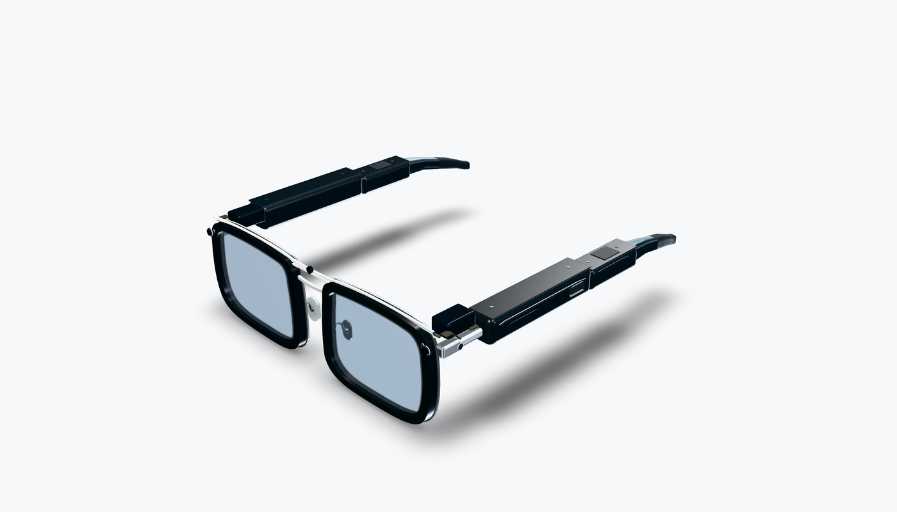
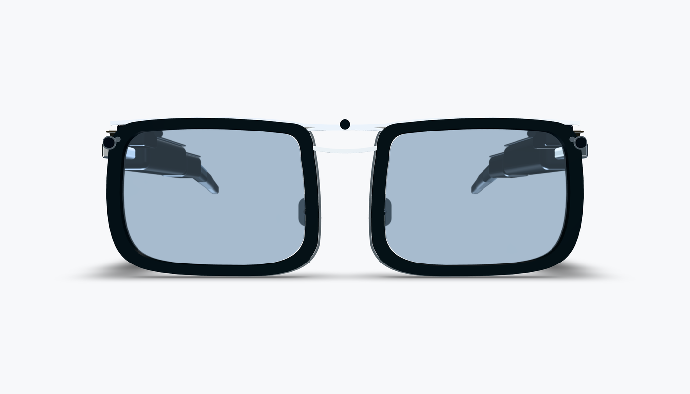
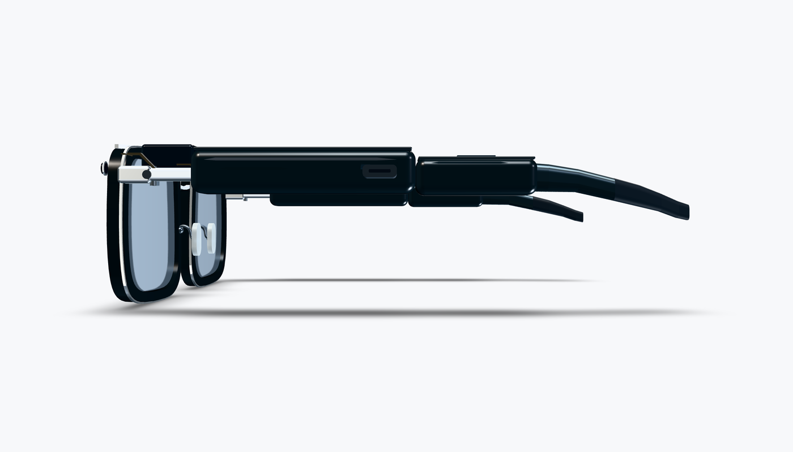
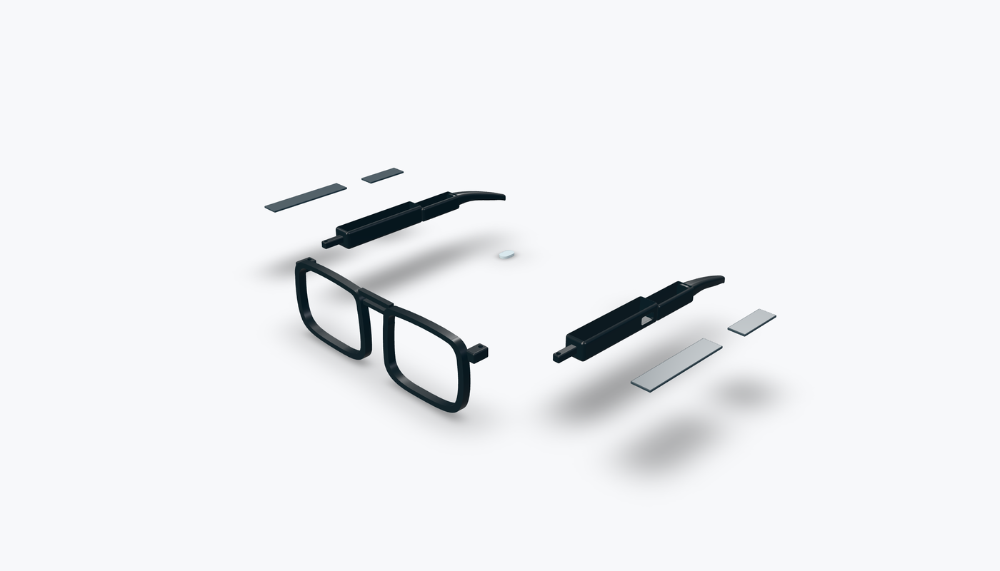

# E.D.I.T.H.
### Next-Generation Adaptive AR Smart Glasses

**A modular, AI-powered augmented reality eyewear project designed to combine intelligent assistance, adaptive vision, and premium wearable engineering.**

[Overview](#overview) • [Features](#planned-features) • [Hardware](#hardware-architecture) • [CAD](#mechanical-design) • [Roadmap](#development-roadmap)

---

## Overview

**E.D.I.T.H.** is an independent research and development project exploring what the next generation of intelligent eyewear could become.

The vision is to create smart glasses that look like premium everyday eyewear while offering augmented reality, AI assistance, environmental awareness, and personalized optical correction.

Unlike conventional smart glasses, EDITH is being designed around a modular hardware architecture, allowing components to be replaced, upgraded, and improved as technology evolves.

The project is currently in the **mechanical CAD and hardware feasibility stage**. Functional AR electronics and adaptive prescription optics have not yet been implemented.

## Design Philosophy

EDITH is guided by five principles:

1. **Premium aesthetics** — advanced technology should not require bulky, industrial-looking eyewear.
2. **Modular engineering** — components should be serviceable and upgradeable wherever practical.
3. **Adaptive vision** — explore optical systems that adjust to individual eyesight requirements.
4. **Privacy and user control** — cameras, sensors, and AI capabilities should operate with transparent permissions.
5. **Realistic engineering** — prioritize measurable performance, comfort, safety, and manufacturability over speculative specifications.

## Planned Features

| Feature | Description | Status |
|---|---|---|
| Premium eyewear frame | Black acetate-inspired frame with satin-metal detailing | CAD prototype |
| Adjustable nose pads | Independent fit adjustments for both sides | CAD concept |
| Curved temple tips | Ergonomic rear sections with soft contact surfaces | CAD prototype |
| Modular electronics | Separate processing, power, and sensor compartments | Conceptual layout |
| AR heads-up display | Visual information overlaid on the real world | Research |
| AI assistant | Context-aware, user-controlled intelligent assistance | Planned |
| Computer vision | Environmental recognition through integrated cameras | Planned |
| Eye tracking | Eye-position sensing and gaze-based interaction | Research |
| Adaptive prescription lenses | Electronically adjustable optical power | Research |
| Automatic focusing | Dynamic adjustment between near and distant objects | Long-term research |
| USB-C connectivity | Charging, data, and potential video connectivity | CAD concept |
| Wireless connectivity | Wi-Fi and Bluetooth integration | Planned |
| Modular battery system | Protected power architecture with serviceable components | Research |

Features listed as planned or research are not claims of implemented functionality.

## Adaptive Vision System

One of EDITH's central research goals is to integrate **electronically adjustable prescription correction directly into the eyewear**.

Instead of requiring a completely different pair of glasses for every prescription, a future EDITH optical module could potentially change its optical power through electronic control.

### Proposed capabilities

- Independent optical correction for the left and right eyes.
- User-specific vision profiles.
- Adjustable spherical optical power.
- Research into astigmatism correction, including cylinder and axis.
- Potential automatic near/far focusing.
- Optical calibration coordinated with the AR display.

### Candidate technologies

| Technology | Potential advantage | Main challenge |
|---|---|---|
| Liquid-crystal optics | Thin, electronically controlled elements | Optical range, clarity, and aperture |
| Fluid-based lenses | Variable curvature and optical power | Bulk, seals, and actuation |
| Alvarez optics | Mechanical adjustment of optical power | Precision movement and packaging |

**Important:** No technology has yet been selected or validated for EDITH. A target such as −4.00 diopters is a design use case, not a demonstrated capability.

### Modular optical architecture

The proposed lens assembly consists of:

1. An external protective optical element.
2. An AR waveguide or compatible display optic.
3. A replaceable adaptive optical module.
4. An eye-facing optical interface.

The final optical order and geometry will depend on real optical-engine specifications and professional optical validation.

Conventional prescription inserts are the practical fallback for early prototypes.

## Hardware Architecture

EDITH is being explored as a distributed wearable computing platform.

| Subsystem | Proposed responsibility |
|---|---|
| Main processing module | AR applications, sensor processing, and system coordination |
| Companion processing module | Wireless connectivity and auxiliary workloads |
| Optical subsystem | Display optics, prescription correction, and calibration |
| Camera subsystem | Computer vision and environmental sensing |
| Power subsystem | Battery protection, charging, and power distribution |
| Sensor subsystem | Motion tracking, eye tracking, and environmental sensing |
| Interconnects | Communication and power between frame modules |

### Processing platform

Qualcomm Snapdragon AR2 is under consideration as a potential processing platform.

However, access to reference schematics, development hardware, integration documentation, and commercial requirements remains unresolved.

**No custom Snapdragon AR2 PCB has been designed or validated.**

Alternative processing platforms may be evaluated if they offer better documentation, accessibility, or prototyping support.

## Mechanical Design

The current mechanical model is developed in **kernelCAD**.

### EDITH V2.4 — Wearability & Serviceability Study

[**View the latest CAD model**](https://app.kernelcad.com/p/Ru_P5aCU?version=16)

Current modeled elements include:

- Sculpted black acetate-inspired lens frames.
- Satin titanium-style exterior accents.
- Blue-silver lens representations.
- Thin metallic browbar.
- Electronics and battery compartment envelopes.
- Independently adjustable nose-pad geometry.
- Curved temple tips.
- Conceptual hinge and service-access details.
- Disassembled 3D-printable fit-check components.

The CAD model includes an assembled concept and a separate prototype parts layout.

### V2.4 CAD gallery

These images are renders of the [kernelCAD V2.4 concept source](cad/edith-v2.4.kcad.ts), **not photographs of working hardware**.

| Assembled three-quarter view | Front elevation |
| --- | --- |
|  |  |

| Side elevation | Exploded fit-kit study |
| --- | --- |
|  |  |

The exploded view is a conceptual print-fit kit; its components are not a validated assembled product.

### Source files and reproducibility

- [Editable kernelCAD V2.4 source](cad/edith-v2.4.kcad.ts) — pinned to [kernelCAD revision 16](https://app.kernelcad.com/p/Ru_P5aCU?version=16).
- [STEP geometry export](cad/edith-glasses-v2.4.step) — provided for CAD inspection and mechanical reference; export equivalence has not been independently checked.
- [CAD usage notes](cad/README.md) — explains the conceptual model and current mechanical limitations.
- [Adaptive optics research plan](docs/research/adaptive-optics.md) — requirements and experiments, not validated vision correction.
- [CAD render assets](images/README.md) — front, side, three-quarter, and exploded views.

**Version note:** The linked source is pinned to the V2.4 revision. Later experiments in the kernelCAD workspace may have different version numbers; this repository does not automatically synchronize with them.

### 3D Printing

The initial physical fit-check workflow targets the **Bambu Lab A1 mini**.

Proposed materials:

| Component | Candidate material |
|---|---|
| Structural frame | PETG |
| Temple housings | PETG |
| Removable covers | PETG |
| Comfort components | TPU |
| Hinges and fasteners | Metal hardware |

These material choices are preliminary.

The current print kit is intended for dimensional and ergonomic experimentation. It is not a validated manufacturing assembly.

## Electronics and PCB Development

The planned electronics workflow is:

**Schematic design → PCB layout → Mechanical integration → Fabrication → Testing**

Candidate tools include:

- **KiCad** for electronic schematics and PCB layout.
- **kernelCAD** for mechanical integration and clearance studies.
- A qualified PCB manufacturer for fabrication and assembly.

Development should begin with manageable subsystems such as power management, charging, sensor interfaces, and low-power controllers before attempting a highly integrated AR processing board.

High-speed interfaces, RF performance, battery protection, thermal management, and optical connections will require dedicated validation.

## Software Architecture

The long-term software architecture is expected to include:

- Embedded firmware and device management.
- Sensor and camera abstraction.
- AR rendering and interface services.
- AI assistance and tool integration.
- Vision-profile and optical calibration management.
- Secure communications with companion devices.
- Permission-based access to sensitive sensors.

EDITH is intended to be user-controlled, with clear permission boundaries for cameras, microphones, location, and external actions.

The software stack has not yet been finalized.

**Project tracking:** [V2.4 CAD concept prerelease](https://github.com/Arnost55/E.D.I.T.H/releases/tag/v2.4-cad-preview) · [V2.5 mechanical milestone](https://github.com/Arnost55/E.D.I.T.H/milestone/1) · [Engineering issues](https://github.com/Arnost55/E.D.I.T.H/issues)

## Project Status

**Current stage: Mechanical prototyping and feasibility research**

| Area | Current progress |
|---|---|
| Visual design direction | Established |
| Mechanical CAD | V2.4 completed |
| CAD geometry evaluation | Passed |
| Physical frame fit | Not validated |
| Production-ready hinges | Not validated |
| PCB schematics | Not started |
| Functional AR display | Not implemented |
| Adaptive prescription correction | Research |
| Battery and thermal testing | Not started |
| Wearable software | Planning |

CAD validation confirms that the modeled geometry can be evaluated. It does not establish real-world fit, strength, optical performance, thermal safety, or electrical functionality.

## Development Roadmap

### Phase 1 — Industrial Design
- [x] Establish premium eyewear styling.
- [x] Create initial parametric CAD model.
- [x] Add electronics compartment envelopes.
- [x] Add adjustable nose-pad concepts.
- [x] Refine temple-tip geometry.
- [x] Complete EDITH V2.4 CAD revision.

### Phase 2 — Mechanical Prototype
- [ ] Select real hinge hardware.
- [ ] Design mechanically retained covers.
- [ ] Define manufacturing tolerances.
- [ ] Print and assemble a fit-check prototype.
- [ ] Measure comfort, weight, and balance.
- [ ] Test durability and repeated assembly.

### Phase 3 — Electronics
- [ ] Select an accessible processing platform.
- [ ] Obtain component documentation.
- [ ] Develop power-management schematics.
- [ ] Design initial prototype PCBs.
- [ ] Validate electrical and thermal performance.
- [ ] Integrate sensors and connectivity.

### Phase 4 — AR and Computer Vision
- [ ] Select a compatible optical engine.
- [ ] Integrate display hardware.
- [ ] Develop a basic AR interface.
- [ ] Prototype camera and sensor pipelines.
- [ ] Implement user-controlled AI features.

### Phase 5 — Adaptive Vision
- [ ] Evaluate electronically tunable optical technologies.
- [ ] Define prescription correction requirements.
- [ ] Prototype a replaceable optical cartridge.
- [ ] Characterize optical quality and distortion.
- [ ] Investigate automatic focus adjustment.
- [ ] Complete appropriate optical and safety validation.

### Phase 6 — Wearable Integration
- [ ] Integrate electronics into the frame.
- [ ] Optimize battery life and heat dissipation.
- [ ] Validate long-duration comfort.
- [ ] Conduct reliability and safety testing.
- [ ] Prepare a functional demonstration prototype.

## Engineering Challenges

EDITH faces several substantial engineering challenges:

**Optical integration:** Combining AR waveguides with prescription correction without unacceptable distortion or image degradation.

**Miniaturization:** Packaging computing hardware, sensors, batteries, and connectors within a wearable frame.

**Thermal management:** Keeping electronics and skin-contact surfaces within safe temperatures.

**Power consumption:** Balancing computational performance with practical battery life.

**Mechanical durability:** Designing lightweight hinges, serviceable covers, and reliable flexible interconnects.

**Safety and privacy:** Protecting battery systems and ensuring responsible operation of cameras and AI capabilities.

These challenges are active research areas, not solved features.

## Contributing

EDITH is an early-stage independent project.

Contributions, technical feedback, and collaboration proposals are welcome in areas such as:

- Mechanical and industrial design.
- Optical engineering.
- Embedded electronics.
- PCB development.
- Computer vision.
- AR software.
- Power management and thermal engineering.

Please read [CONTRIBUTING.md](CONTRIBUTING.md) and open a GitHub issue to discuss substantial changes before beginning implementation. The project is not currently distributed under an open-source license.

## Disclaimer

EDITH is an experimental research and prototyping project.

It is not a certified medical device, approved prescription eyewear product, or commercially validated AR system.

Any future prescription-correcting optics must undergo appropriate professional evaluation and testing before being relied upon for vision correction.

References to third-party technologies or design inspirations do not imply endorsement, partnership, or affiliation.

## License

A project license has not yet been selected. See [LICENSE](LICENSE) for the temporary all-rights-reserved notice.

Until a license is published, the repository's contents should not be assumed to be open-source licensed.

---

### E.D.I.T.H.

**Intelligent vision. Adaptive optics. Premium engineering.**

*Building toward a future where wearable computing becomes a natural part of everyday life.*

